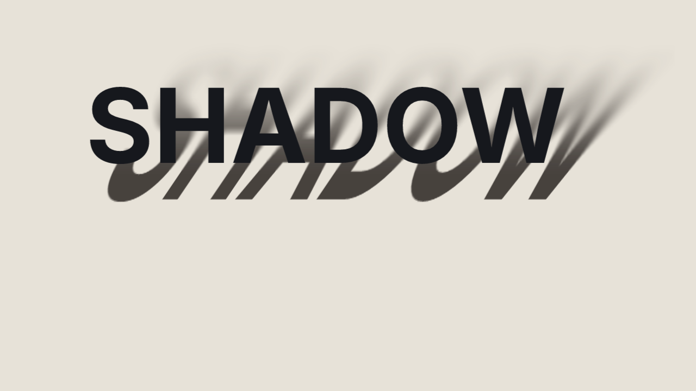
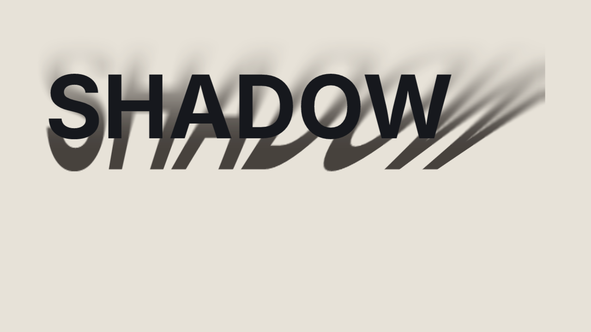

# mos_shadow · 方向轴阴影

EffectCraft 的 WebAssembly 效果插件：把所属图层的轮廓沿一条**基线**和一个**方向/长度轴**拉伸成投影。阴影离基线越远越模糊、越透明，颜色可调；还能用**远端放大**让阴影离基线越远越宽。思路接近 Red Giant VFX Shadow 的简化版。



## 安装

要求 EffectCraft 0.24 或更新版本（效果插件 ABI 1）。

1. 把 `dist/mos_shadow/mos_shadow.wasm` 复制到：
   `%APPDATA%\EffectCraft\Plug-ins\`
2. 重启 EffectCraft，或在已经打开的 EffectCraft 里用 **Effect ▸ Load Effect Plug-in…** 选中这个 wasm。
3. 在 **Effects & Presets** 里搜索 `mos_shadow`，分类是 **MOS**。

命令行加载：

```json
{"id":"effect.plugins.load","params":{"path":"...\\mos_shadow.wasm"}}
```

## 快速上手

1. 选中一个文字、形状或带透明通道的图层，应用 `mos_shadow`。
2. 把**基线起点**和**基线终点**放到物体“接触地面”的那条线上（通常就是文字底部）。
3. 把**方向/长度**点拖到阴影应该结束的位置。
4. 调**最大模糊**和**模糊起点**，再调**不透明度**、**淡出起点**。

```
A（基线起点）───────────── B（基线终点）   ← 阴影从这里开始
        ╲
         ╲  W = C − 基线中点
          ╲
           C（方向/长度）                  ← 阴影伸到这里
```

- 基线：阴影的“截断线”。源图层靠近基线的边缘锚定在 `t=0`，最远的边缘锚定在 `t=1`。
- 第三点：它到基线中点的向量 `W` 同时决定**长度**和**剪切方向**。`C` 在基线中点的正上方时是垂直拉伸；偏向一侧时阴影会斜着倒。
- 三个点都是图层像素坐标；在 Effect Controls 里可以直接改数值，默认值按图层尺寸的百分比给出。

## 参数

| 参数 | 类型 | 默认 | 范围 | 说明 |
|---|---|---:|---:|---|
| 基线起点 | point | [0.12, 0.62] | — | 基线 A，图层尺寸的比例；实际值是图层像素 |
| 基线终点 | point | [0.88, 0.62] | — | 基线 B |
| 方向/长度 | point | [0.70, 0.24] | — | 第三点 C；`W = C − mid(A,B)`，W 的模长是阴影长度 |
| 最大模糊 | slider | 24 px | 0–300 | 阴影末端（`t=1`）的模糊半径 |
| 模糊起点 | slider | 10 % | 0–100 | 从阴影长度的这个位置开始增加模糊 |
| 模糊终点 | slider | 100 % | 0–100 | 到这个位置达到最大模糊 |
| 不透明度 | slider | 80 % | 0–100 | 阴影的整体不透明度 |
| 淡出起点 | slider | 20 % | 0–100 | 从这里开始降低不透明度 |
| 淡出终点 | slider | 100 % | 0–100 | 到这里不透明度降到 0 |
| 阴影颜色 | color | 近黑 | — | 含 alpha；RGB 不预乘 |
| 阴影源 | popup | Alpha | Alpha / Luminance | 用图层 alpha 还是亮度当阴影形状 |
| 阴影在图层后 | checkbox | 开 | — | 关掉则阴影盖在源图层前面 |
| 只显示阴影 | checkbox | 关 | — | 调试用：输出只有阴影 |
| 远端放大 | slider | 0 % | -100–200 | 以基线为锚点；`t=1` 处切向宽度乘 `1 + expand/100`，负值收窄 |

`t` 是阴影轴上的归一化位置：`t=0` 在基线，`t=1` 在第三点。模糊和淡出都按 `t` 插值；远端放大只缩放切向宽度，不改变长度、模糊和淡出曲线。

## 远端放大



`expand` 以基线为锚点：`t=0` 不缩放，`t=1` 处切向尺寸乘 `1 + expand/100`，中间线性过渡。正数让阴影在远端像被拉开一样变宽，负数让远端收尖；0 时与旧版完全一致。

## 算法

1. **基线坐标系**：`L = normalize(B−A)`，`N = perp(L)`，并让它朝向第三点。`W = C − (A+B)/2`，`Wn = dot(W,N)`，`Wu = dot(W,L)`。`Wn` 太小（第三点落在基线上）时不产生阴影。
2. **KEY 平面与源高度范围**：先扫一遍图层，把 alpha（或亮度）写进单通道 `KEY` 平面，同时记录 key > 0.004 的像素 bbox 和相对基线的法向高度 `h = dot(P−A,N)`，取 `h_min/h_max`。离 0 更近的一端是 `anchor`，另一端是 `far`，`span = far − anchor`。后面的双线性采样只读 `KEY` 一个通道。
3. **逆映射**：对输出像素 `Q`，`t = dot(Q−A,N) / Wn`。`t` 不在 `[0,1]` 就不写。否则源高度 `h = anchor + t·span`，切向坐标 `uQ = dot(Q−A,L) − t·Wu`。源切向范围 `u_min/u_max` 由源 bbox 四角投影到 `L` 得到，中心 `u_mid = (u_min+u_max)/2`；远端缩放 `s = 1 + expand/100·t`，实际采样坐标 `uP = u_mid + (uQ − u_mid)/s`，源点 `P = A + uP·L + h·N`，双线性采样 `KEY`。`s=1` 时与旧版映射完全一致。填充时逐行用增量更新 `t/u/h`；`expand≠0` 时每像素多做一次除法。
4. **渐进模糊**：填充阴影 alpha 时同时把半径写进 `RAD` 缓冲；再做水平、垂直两遍**变半径 box blur**。每个像素的半径是
   `r = blur · scale · smoothstep(blur_start/100, blur_end/100, t)`。
   每行/列维护滑动窗口和 running sum，按实际窗口像素数归一化。`scale` 是预览分辨率相对图层分辨率的比例，所以半分辨率预览的模糊看起来一致。
5. **透明度与合成**：`sa = sh · opacity/100 · (1 − smoothstep(fade_start/100, fade_end/100, t)) · color.a`。`behind` 时 `out = src + color·sa·(1−src.a)`；否则 `out = color·sa + src·(1−sa)`；`only_shadow` 时只输出 `color·sa`。所有通道按预乘 RGBA 写回。

内存布局：宿主用 `ec_alloc` 预留 `3×n`，其中 `n = 20×8 + W×H×16`（14 个参数）。参数和像素在返回区，后面紧接 `SH/TMP/RAD/KEY` 四个 `W×H×4` 平面。填充/模糊/合成只在阴影 bbox 内进行，bbox 外由一次 `SH/TMP` 清零保证读到 0。纯 wasm，无 import，确定性渲染。

## 调参建议

- **写实的长投影**：基线贴住物体底部，第三点向右上方拉远；`blur 20–40`，`blur_start 10–20`，`opacity 60–85`，`fade_start 20–50`。
- **远端张开的透视感**：`expand 40–120`，同时把 `blur_start` 压到 10 左右、`fade_start` 拉高，避免远端既宽又太糊。
- **硬边图形阴影**：`blur 0`，`fade_start = fade_end = 100`（末端之外几乎不淡）。
- **第三点太靠侧面**会把阴影拉得很斜，文字会变成斜条纹；想要“压扁”的感觉就让 `C` 更靠近基线中点的正上方。
- **阴影方向反了**：把第三点放到基线的另一侧，或者交换基线起点/终点；`N` 会自动朝向第三点。
- **只显示阴影**打开后可以单独看形状和模糊，确认基线位置。

## 限制

- **会被图层边界裁切**。这个插件是 wasm ABI 1，拿不到图层的 `origin` / `padding`；EffectCraft 的 wasm 效果只能在图层自己的像素缓冲里画。文字层、形状层通常是合成大小，空间足够；**紧边 PNG / 视频素材**的阴影超出素材边界时会被切掉。解决办法：把素材放进一个带透明留白的预合成，或先把素材放到合成大小的图层里。原生 API 2 插件可以通过 `padding()` 申请扩边，wasm 插件不行。
- **没有合成视图 overlay**。wasm 插件没有画线/画手柄的钩子，宿主只画三个 point 参数的十字手柄；Effect Controls 里能看到并拖动三个点，但线和连接手柄不会出现。想要真连线只能用 ScriptUI 面板或 guide shape layer + 表达式。
- 阴影是**仿射拉伸**：基线 + 方向轴决定长度和剪切，没有真正的透视汇聚。需要透视感时，把第三点拉远并配合模糊/淡出；需要远端张开时用 `expand`。
- **远端放大**是切向线性缩放，不是真透视；`expand` 很大时远端会明显变宽，可能超出图层/画面边界。
- 所有计算在图层空间；图层移动、缩放、旋转后，三个点和阴影会一起跟着图层变换走。
- `阴影源 = Luminance` 时，亮部投出的阴影更强；对黑底白字/火焰素材更有用。
- 模糊/淡起的“起点”应小于“终点”；反过来会得到一个硬台阶。

## 构建与测试

```bash
npm install
npm run build          # src/mos_shadow.wat + src/manifest.json -> dist/mos_shadow/mos_shadow.wasm
npm test               # 假宿主自测，输出 tests/01-basic.png、02-fade.png、03-blur.png、06-expand.png、06-expand-100.png
# 12 次平均基准（可选）：
$env:BENCH='1'; $env:W='1280'; $env:H='720'; node tools/test_wasm.js
```

720p 基准：

```powershell
$env:W='1280'; $env:H='720'; node tools/test_wasm.js
```

本机实测（RTX 3050 Ti 笔记本，纯 wasm，12 次平均；不含合成/渲染）：

| 分辨率 | 基础阴影 | 渐进模糊 | 宽文字层（模糊 30） |
|---|---:|---:|---:|
| 480×320 | 2–3 ms | 3–4 ms | 3–4 ms |
| 1280×720 | 10–12 ms | 13–14 ms | 18–20 ms |

0.2.0 → 0.3.0 的 bbox、KEY 单通道平面、增量逆映射和半径预计算优化后，720p 渐进模糊从 47–49 ms 降到 13–20 ms（约 2.5–3.7×）。0.4.0 增加远端放大；`expand=0` 时走原来的增量路径，720p 基础阴影约 10.8 ms；开启 `expand=60` 后约 13.2 ms（每像素多一次除法）。

## 目录

```
src/manifest.json        插件清单与参数
src/mos_shadow.wat       手写 WAT（ABI 1）
build.js                 注入 manifest、wabt 编译、组装 dist
tools/test_wasm.js       假宿主测试与 PNG 输出
dist/mos_shadow/         可安装的 wasm + README + 预览图
demo/                    EffectCraft 演示工程（基础 / 远端放大）
docs/preview.png         预览图
docs/preview-expand.png  远端放大预览
```
